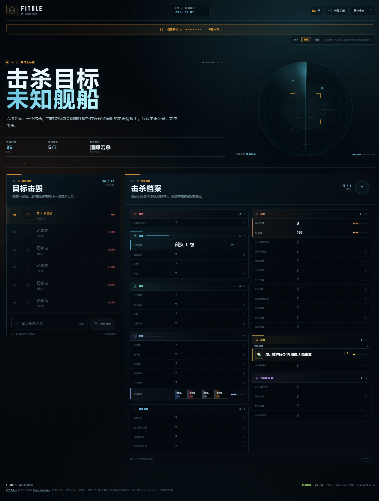
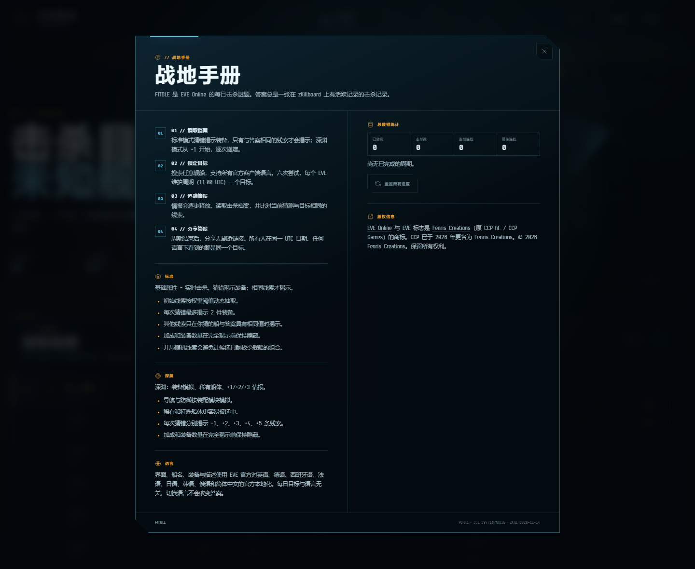
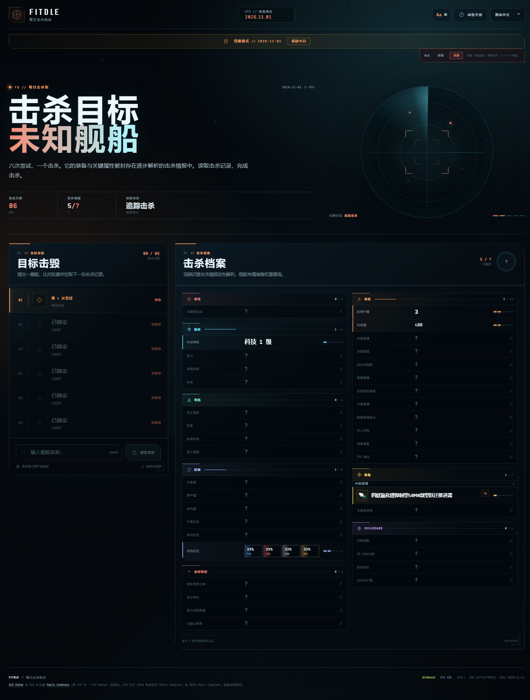

# FITDLE

**版本 0.1.4。** EVE Online 每日击杀谜题：读取一张 killmail 的装配与属性，在 6 次尝试内锁定被害船。



*截图使用档案日期，避免剧透当天题目。*






FITDLE 是一个纯前端、无需登录的 EVE Online 每日谜题。每天有一张目标 killmail；
你只能看到逐步解密的装配和舰船属性，要在 6 次尝试内猜出被害船。所有玩家在同一天、
同一模式下面对同一目标；切换语言不会改变答案。

---

## 怎么玩

1. 打开 [FITDLE](https://cmy.gitlab.io/fitdle/)。
2. 阅读右侧情报：特性、船体、导航、防御、TARGETING、装配、装备和 zKillboard 数据。
3. 在搜索框输入舰船名称并提交。
4. 每次猜测会揭示与目标相同的数值，并解锁更多线索。
5. 6 次内命中即胜利；失败会公布目标。

初始线索数量不固定：系统按权重抽取，并保证初始候选不少于 6 艘。未解密的值显示 `?`。

### 标准模式

- 猜错时按装备数量和权重预算揭示装备；
- 低权重装备更容易先出现；
- 抽到高权重装备时，本次揭示数量会减少；
- 其他属性线索在猜测与目标拥有相同值时揭示。

### 深渊模式

- 按 **全 V 技能、所有已装配装备生效** 模拟；
- 稀有和低使用率船体比标准模式更常见；
- 第 1/2/3/4/5 次猜错分别增加 `+1/+2/+3/+4/+5` 条线索；
- 低权重线索更容易先出现；
- 没有装备或装备全部揭示时，数量会落到其他线索。

### 操作

- `Enter`：提交猜测 / 确认当前操作
- `Esc`：关闭弹窗或搜索建议
- 右上角：切换标准/深渊、语言、字体、战地手册
- 结算：复制不带剧透的分享链接
- 战地手册底部：查看统计，或确认后重置全部本地进度

### 统计与隐私

- 不需要账号，不连接后端数据库。
- 进度和统计只保存在浏览器 `localStorage`：
  - `fitdle:v1:state:*`：当天进度
  - `fitdle:v1:stats`：游玩次数、胜利、连胜、最佳连胜
  - `fitdle:v1:lang`：语言
- 不同域名的 `localStorage` 互相独立；切换域名会看到不同的统计。
- 自由模式不计入统计，也不写入当天进度。
- 游戏运行时向 zKillboard、ESI、EVE 图片服务发起请求；不会把图片或 killmail 缓存在仓库。
- 页脚显示 `v版本 · SDE 官方 build · ZKILL 服务器日期`；不是本地构建哈希。

## URL 指南

| 参数 | 示例 | 作用 |
| --- | --- | --- |
| `d` | `?d=2026-11-13` | 打开指定游戏日的档案；不能晚于当前游戏日 |
| `mode` | `?mode=abyss` | 深渊模式；缺省为标准模式 |
| `lang` | `?lang=zh` | 强制语言：`en` `de` `es` `fr` `ja` `ko` `ru` `zh` |
| `kb` | `?kb=139925340` | 自由模式：直接以该 killmail 为目标，可叠加 `mode=abyss` |

所有中文变体（`zh-CN`、`zh-Hant`、`zh-TW`、`zh-HK`、`zh-SG` 等）统一显示简体中文。

### 自由模式

- 不提供 UI 入口，只能通过 URL 进入：
  - `?kb=<killmail_id>`：标准模式
  - `?kb=<killmail_id>&mode=abyss`：深渊模式
- 目标就是该 killmail 的被害船，不参与每日选题。
- 不记录统计，不保存当天进度。
- 分享链接为 `?kb=<id>&mode=<normal|abyss>&lang=<lang>`。
- 同时带 `kb` 和 `d` 时，`d` 会被忽略。

### 分享链接

正式模式的分享按钮会生成：

```text
/share/3/zh.html?d=2026-11-15&mode=normal&lang=zh
```

- 分数页为 `share/1..6/<lang>.html`，失败页为 `share/lost/<lang>.html`；
- 页面带有本地化 Open Graph 标题、描述和 1200×630 预览图；
- 预览图按 **语言 + 成绩** 分别生成：6 个成绩、失败页、8 种语言共 56 张；
- Discord 等平台会显示对应语言和成绩的预览；
- 预览只包含成绩和宣传语，不包含答案、killmail ID 或装备；
- 打开后自动跳回谜题，并保留日期、模式和语言。

---

## 自托管

### 环境要求

- Node.js **20+**
- Git
- 能访问 zKillboard、ESI 和 `images.evetech.net`
- 一个静态文件托管服务，或 GitLab Pages

### 本地运行

```bash
git clone https://gitlab.com/cmy/fitdle.git
cd fitdle
npm install

# 第一次准备数据
npm run prepare:sde
npm run build            # 先生成 data/catalog.json
npm run build:weights    # 需要上一步的 catalog
npm run build:killpool
npm run build

# 启动本地静态服务器
npm start
# http://127.0.0.1:4173/
```

`npm start` 服务 `dist/`。`dist/` 就是最终可部署产物。

### 数据准备说明

| 命令 | 作用 | 需要网络 |
| --- | --- | --- |
| `npm run prepare:sde` | 下载、解压并标准化官方 SDE | 首次需要 |
| `npm run build:weights` | 获取全部 SDE 船型的 zKill 使用频率 | 需要 |
| `npm run build:killpool` | 生成离线 KB 回退池，并记录 zKill 服务器时间 | 需要 |
| `npm run build` | 生成 `data/` 和 `dist/` | 不需要 |
| `npm test` | 运行测试 | 不需要 |

缓存位于 `.cache/`：

- `.cache/normalized.json`：标准化 SDE
- `.cache/ship-weights.json`：船型使用频率
- `.cache/killpool.json`：回退 KB 池
- `.cache/sde-meta.json`：官方 SDE build/ETag 信息

这些文件不应提交。删除缓存后重新执行上面的数据命令即可。

### 部署到任意静态托管

```bash
npm run build
```

把 `dist/` 整个目录上传到 Nginx、Cloudflare Pages、GitLab Pages、S3 等静态托管。
不需要 Node 运行时，也不需要服务器端 API。

如果使用自定义域名，建议设置构建变量：

```bash
SITE_URL=https://your-domain.example
```

它用于生成分享页的绝对 `og:image` 地址。

### 部署到 GitLab Pages

仓库已包含 `.gitlab-ci.yml`，作业为：

- `sde:check`：检查官方 SDE 是否有更新
- `build`：有需要时刷新 SDE/回退池/船型权重，然后构建并测试
- `pages`：把 `dist/` 发布到 GitLab Pages

首次推送后，在 GitLab：

1. 确认 **Settings → Pages** 已启用；
2. 如需公开访问，将 Pages 访问级别设为 **Everyone**；
3. 等待 `pages` 作业成功；
4. 访问项目提供的 Pages URL，通常为：

```text
https://<namespace>.gitlab.io/<project>/
```

GitLab 的 Pages 域名可能是唯一的 `*.gitlab.io` 地址；以 CI `pages` 作业输出的 URL 为准。

### 每日 downtime 检查

EVE downtime 通常为 **11:00 UTC**。建议在 GitLab 创建每日 schedule：

```text
Settings → CI/CD → Schedules
Interval Pattern: 15 11 * * *
Cron timezone: UTC
Target branch: 默认分支
```

11:15 UTC 给官方 SDE 发布留出时间。GitLab 不会从 YAML 自动创建 schedule，需要手动添加一次。

可选变量：

- `FORCE_SDE=1`：强制刷新 SDE

### 更新流程

#### 更新 SDE

```bash
npm run update:sde
npm run build:killpool
npm run build
npm test
```

#### 更新船型使用频率

```bash
npm run build:weights -- --refresh
npm run build
npm test
```

#### 更新深渊模拟引擎

```bash
npm run update:dogma
npm test
npm run build
```

更新后手动打开一次深渊模式，确认 WASM、SDE 和装备模拟正常。

### 运维注意事项

- SDE 更新、KB 回退池刷新或船型权重刷新会改变数据版本，使**当天未完成进度**失效；历史统计和连胜不会直接清空。
- 运行时的 KB 查询使用固定完整自然月和第 1 页，以保证所有玩家一致；不要改成当前月或翻页。
- zKillboard API 可能限流。失败时游戏会降级为 SDE 线索，但不会泄露答案。
- 某些从未有 zKill 损失的纪念/特殊船没有可用的 KB，因此不在可出题池中。
- `dist/` 和 `.cache/` 都是生成物，不要提交。
- 版本号默认每次 commit 自动 patch；需要 minor/major 时显式指定。

### 版权与许可

FITDLE 是非官方粉丝作品，与 Fenris Creations、CCP 和 zKillboard 无隶属关系。

- EVE Online 与 EVE 标志是 **Fenris Creations（原 CCP hf.）** 的注册商标；
- 游戏数据、图片和相关知识产权属于 Fenris Creations；
- zKillboard 数据属于其各自所有者；
- 本项目代码以 MIT 发布。

完整版权声明见页脚和战地手册，也可参考 [NOTICE.md](NOTICE.md) 与 [LICENSE](LICENSE)。

---

## 开发与 AI 说明

工程架构、数据版本、构建细节、测试清单和发布注意事项已移到：

**[AGENTS.md](AGENTS.md)**

普通玩家和自托管用户只需要本 README；修改代码、数据规则或部署流水线前，请先阅读 `AGENTS.md`。
