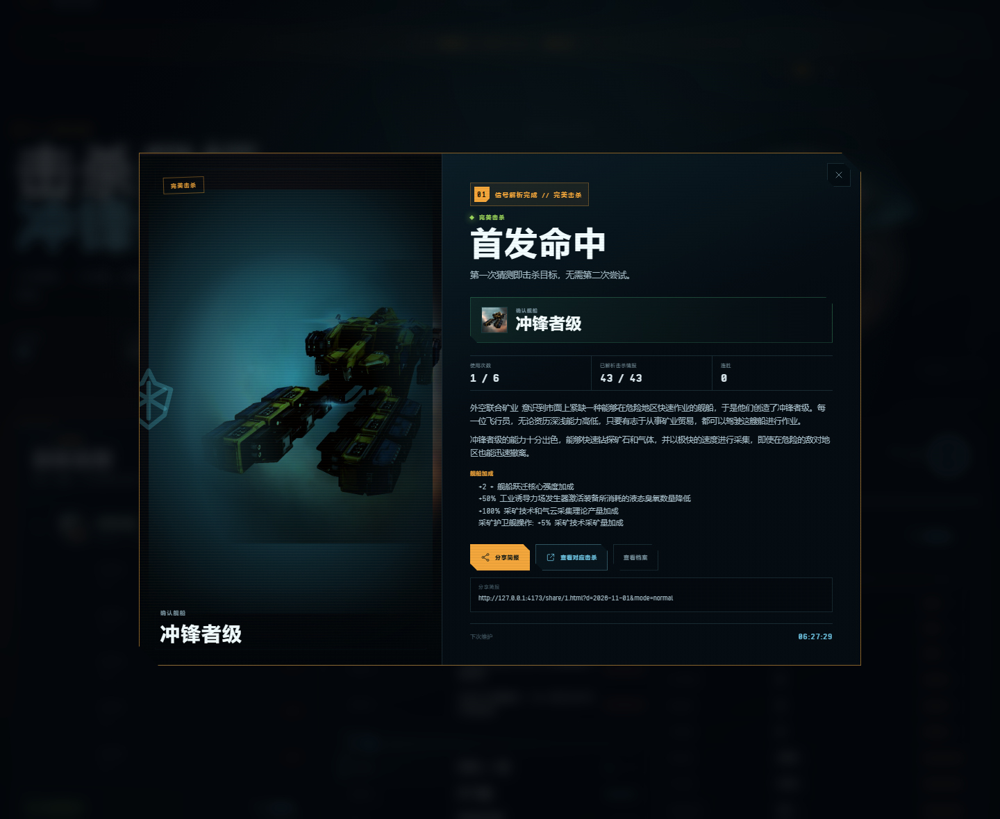
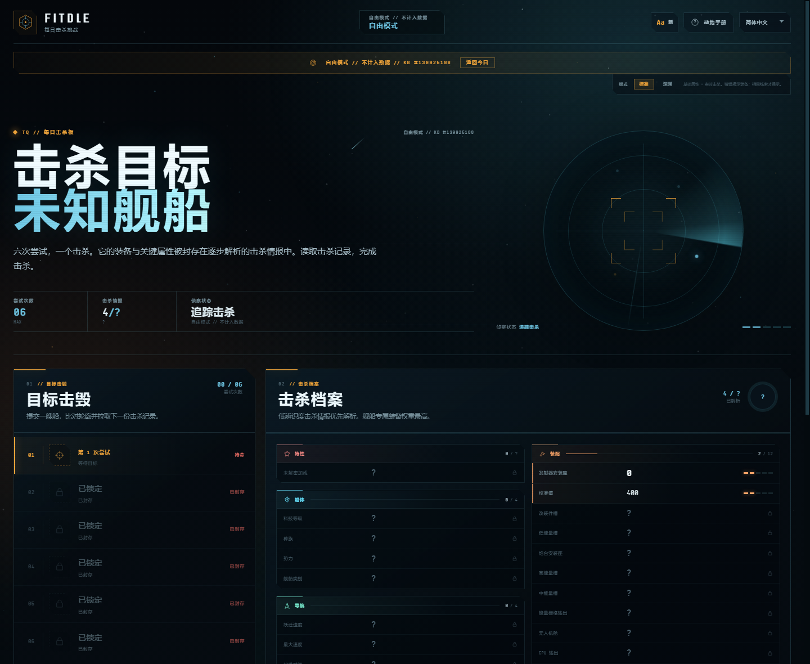

# FITDLE

**版本 0.0.1。** EVE Online 每日击杀谜题：读取一张 killmail 的装配与属性，在 6 次尝试内锁定被害船。


*截图使用档案日期，避免剧透当天题目。*





---

## 快速开始

```bash
npm start
# http://127.0.0.1:4173/
```

`npm start` 服务 **`dist/`**。

### 构建

```bash
# 首次构建需要准备 SDE
npm run build:killpool   # 刷新船型资格池/离线回退池
npm run build            # 生成 dist/
```

`build:killpool` 需要网络；已有的 `.cache/killpool.json` 可离线复用。

### URL 参数

| 参数 | 示例 | 作用 |
| --- | --- | --- |
| `d` | `?d=2026-11-13` | 指定 EVE 游戏日档案；不得晚于当前游戏日 |
| `mode` | `?mode=abyss` | 深渊模式；缺省标准 |
| `lang` | `?lang=zh` | 强制语言：`en` `de` `es` `fr` `ja` `ko` `ru` `zh` |
| `kb` | `?kb=139925340` | **自由模式**：直接以该 killmail 为目标；可叠加 `mode=abyss` |

正式模式的分享链接指向 `share/{1..6}.html` 或 `share/lost.html`，带 `d` 与 `mode`（标准/深渊都包含）。静态页的 Open Graph 标题/描述包含成绩。

### 自由模式

- 不提供 UI 选项，只能通过 URL 进入：
  - `?kb=<killmail_id>`：标准模式；
  - `?kb=<killmail_id>&mode=abyss`：深渊模式。
- 目标就是该 KB 的被害船，不参与每日选题。
- **不计入统计**：不调用成绩记录、不写本地进度。
- 仍可分享，分享链接只保留 `kb=<id>` 与 `mode=<normal|abyss>`，不包含日期、语言或成绩页。
- 仍使用伪随机线索顺序和非谜题随机效果。
- 语言、模式切换、装备/雷达/结算等玩法与正式模式一致。
- 顶部 banner 显示自由模式、KB ID、不计入数据，并提供“返回今日”。
- URL 同时带 `kb` 与 `d` 时，`d` 被忽略，谜面强制为该 KB。



---

## 玩法

- 每天一张具体 killmail，在 **EVE downtime（11:00 UTC）** 切换。
- 选题顺序：先选船型，再在运行时查该船型最近完整自然月的 KB。
  - `killShipPool` 只负责资格船型；
  - KB 主路径：`/api/losses/shipTypeID/{id}/year/{Y}/month/{M}/`；
  - 使用档案日期的上一个完整 UTC 月，列表固定，所有玩家一致；
  - 最多向前回溯 6 个月；
  - 静态 `killPoolsByShip` 仅在 zKill 不可用或查询为空时作离线回退。
- 6 次尝试，每次回答被害船名。
- 初始线索不固定数量：
  - 按权重阈值伪随机抽取，直到累计权重超过 9；
  - 最大权重 13、最多 7 条；
  - 初始候选集不得少于 6 艘；
  - 唯一/限定装备不会进入初始线索。
- **标准模式**：每次猜错最多解密 2 条装备；其他线索只在猜测与目标同值时揭示。
- **深渊模式**：初始数量同样由阈值决定；第 1/2/3/4/5 次猜错分别增加 +1/+2/+3/+4/+5 条。
- 右侧档案分组：**特性 / 船体 / 导航 / 防御 / TARGETING / 装配 / 装备 / ZKILLBOARD**。
- 货舱容量、电容容量归入装配。
- 装配顺序固定为：炮座、发射器座、高、中、低、改装件槽、CPU、PG、电容、货仓、无人机仓；校准值放在末尾。
- TARGETING：信号半径、扫描分辨率、锁定范围上限、最大锁定数量。
- 防御：护盾/装甲/结构各一条血量，另加三层抗性（EM/热能/动能/爆炸）。
- 槽位配置拆成高/中/低/改装件各自独立条目。
- 武器安装座拆成炮台安装座、发射器安装座两条。
- ZKILLBOARD 分组包含 30 天损失、使用排名、危险指数、当前 killmail 总价值；组内不重复写来源。
- 深渊模式一次揭示 2 条以上时，避免全部是装备或全部是属性：大部分装备时至少混入 1 条非装备，大部分属性时至少混入 1 条装备。
- 未解密值显示 `?`；装备与加成在完全解密前只有一个封存占位。
- 新揭示或匹配命中的线索会高亮后渐隐。
- 结算提供目标 KB 链接；失败时如无样本击杀，回退到该舰船的 zKillboard 页面。
- 第一次猜测即击杀时使用 **ONE SHOT / 首发命中** 结算。
- 复制分享按钮只复制 URL。

### 装备

- 只取目标 killmail 受害者实际装配，不混入同船型其他损失。
- 同名合并，例如 `轻型中子疾速炮 II ×4`。
- 完全揭示后按槽位分组：
  - 高能量槽、中能量槽、低能量槽、改装件槽、子系统、无人机舱、舰载机、货仓。
- 装备行不重复写槽位名，槽位由分组标题表示。
- 多舰船类别通用装备标记 **限定 / LIMITED**。
- 单一舰船类别装备标记 **唯一 / UNIQUE**，权重为 10。
- 货仓物品也纳入装备区；未知类型会在运行时向 ESI 查询名称。
- 高槽弹药与对应高槽武器采用相同权重；唯一武器的弹药也按唯一装备权重 10 计算。
- 装备 size（Capital / X-Large / Large / Medium）计入权重。

### 雷达

- 答题中显示目标渲染图的 **16px 极度像素化、去色**版本，无中心文字。
- 结算后换成清晰 512px 渲染图，位于雷达环后方。

### 战地手册

- 只保留玩法说明，区分标准/深渊，不含字体、快照、权重或 SDE 技术细节。
- **总数据统计**：周期、击杀数、当前连胜、最佳连胜。
- **重置所有进度**：
  - 必须确认；
  - 清除全部 `fitdle:v1:*`，包括已揭示答案与当天进度；
  - 阻止 `pagehide` 写回旧状态并自动刷新。

### 版权

- 页脚与手册只保留一份版权信息。
- **EVE Online** → <https://www.eveonline.com/>
- **Fenris Creations（原 CCP hf. / CCP Games）** → <https://fenris.com/>
- 明确标注：CCP 已于 2026 年更名为 Fenris Creations。
- 右下角：`v0.0.1 · SDE <dataVersion> · ZKILL <killpool date>`。

---

## 数据与权重

- SDE 属性来自构建期静态目录。
- 目标 KB 与船型统计来自 zKillboard：
  - `https://zkillboard.com/api/losses/shipTypeID/{id}/year/{Y}/month/{M}/`（固定自然月池）
  - `https://zkillboard.com/api/killID/{killmail_id}/`
  - `https://zkillboard.com/api/stats/shipTypeID/{id}/kills/`
- 图片直接使用 `images.evetech.net`。
- 运行时请求不写入 localStorage，也不下载到构建产物。
- 数值线索按约 **5% 相对容差**视为相同；候选越少、越不容易与其他船混淆，权重越高。
- 标准模式与深渊模式都会应用容差。
- 深渊模式的装备差异会以 add/ratio 形式参与比较（质量、护盾、速度等），使 fitted 数据在容差内仍可匹配。
- 深渊模式线索的**权重仍按 SDE 基础值**计算，避免装配模拟后的复杂数值把权重整体推高。
- 导航/防御/装配数值按 SDE：
  - `warp = baseWarpSpeed × warpSpeedMultiplier`
  - `align = 1.386 × agility × mass / 1,000,000`
- 加成词条会归一化数字；相同模板、不同数值的条目会降低权重。
- 深渊模式使用本地化的 [EVEShip.fit dogma-engine](https://github.com/EVEShipFit/dogma-engine) + patched SDE，按 **全 V 技能 + 装备全开** 模拟。

---

## 构建 SDE

```bash
npm run prepare:sde
```

脚本会：

1. 如果 `.cache/sde-source` 没有完整 SDE，就自动下载官方 `eve-online-static-data-latest-jsonl.zip`；
2. 只解压所需的 JSONL；
3. 生成 `.cache/normalized.json`。

强制下载最新 SDE：

```bash
npm run update:sde
# 等价于 node scripts/prepare-sde.mjs --refresh
```

构建不会下载图片。

## 更新深渊引擎

```bash
npm run update:dogma
npm test
npm run build
```

命令会从 npm 拉取最新的：

- `@eveshipfit/dogma-engine`：JS + WASM；
- `@eveshipfit/sde`：patched `sde.dat`；
- 对应 `LICENSE` / `LICENSE.EVE`。

更新后写入 `vendor/dogma-engine/VERSION.json`，保留现有 `skills.json`。部署前必须手动打开一次深渊模式，确认 WASM、SDE 和计算属性正常。

## GitLab Pages

仓库包含 `.gitlab-ci.yml`：

- `sde:check`：读取 SDE 的 `ETag` / `Last-Modified`，与当前 Pages 的 `data/manifest.json` 比较；
- `build`：SDE 有更新时重新下载/生成 SDE；每日 schedule 与默认分支推送都会构建并测试；
- `pages`：把 `dist/` 复制到 `public/` 并部署 GitLab Pages。

首次构建会自动下载 SDE。构建缓存包含 `.cache/normalized.json`、`.cache/killpool.json` 和 `.cache/sde-meta.json`。

### 每日 DT 检查

在 GitLab：

```text
Settings → CI/CD → Schedules
```

新建 schedule：

- Interval pattern：`15 11 * * *`
- Cron timezone：`UTC`
- Target branch：默认分支
- 可选变量：`FORCE_SDE=1`（强制重建）

EVE DT 通常是 11:00 UTC，因此安排在 11:15 UTC，给 SDE 发布留出时间。GitLab 的 cron 不会自动从 YAML 创建，需要手动添加一次。

### 发布

```bash
git remote add origin <gitlab-project-url>
git push -u origin main
```

Pages URL 由 GitLab 提供，通常为：

```text
https://<namespace>.gitlab.io/<project>/
```

---

## 测试

```bash
npm test
```

当前 **28/28** 通过，覆盖：

- EVE downtime 边界、未来日期拦截
- 目标池、类型→KB 选择、同船不同 KB
- 目标受害者装备隔离、货仓装备
- 槽位配置拆分、当前 KB 总价值
- 阈值初始线索、候选下限
- 相近 SDE 值归并、fit-adjusted 容差、高槽弹药与武器同权、唯一弹药、装备 size/限定/唯一
- 武器安装座拆分、深渊基础值权重
- 深渊多条揭示的装备/属性混合
- 标准/深渊揭示
- 分享 URL 与静态 OG 成绩页
- 8 语言 key 完整性
- 无硬编码部署域名、无本地图片缓存

---

## 已知限制

- KB 主路径是 zKill 的固定自然月查询，不预编译每日目标；静态池只保留 164 张回退 KB / 75 个船型。
- 只读取目标月第 1 页（最多 200 条），列表固定且所有玩家一致；不会翻页扩大范围。
- 船型资格池仍由 `npm run build:killpool` 刷新；只有运行该命令并重新构建时才会改变 `dataVersion` 和重置进度。
- dogma-engine 无法从 killmail 还原角色技能和 Abyssal mutation，因此按全 V 技能、装备全开与 SDE/模块基础属性模拟；与当时的实际飞行状态可能有差异。
- 货仓中的非模块类型在运行时通过 ESI 补名称，第一次加载可能多几个请求。
- zKillboard API 可能限流；失败时降级为 SDE-only 线索。

---

## 许可

代码以 MIT 发布。EVE Online 数据/图片属于 **Fenris Creations（原 CCP hf. / CCP Games）**，zKillboard 数据属于其所有者；详见 [NOTICE.md](NOTICE.md) 与 [LICENSE](LICENSE)。

FITDLE 是非官方粉丝作品，与 Fenris Creations 和 zKillboard 无隶属关系。
