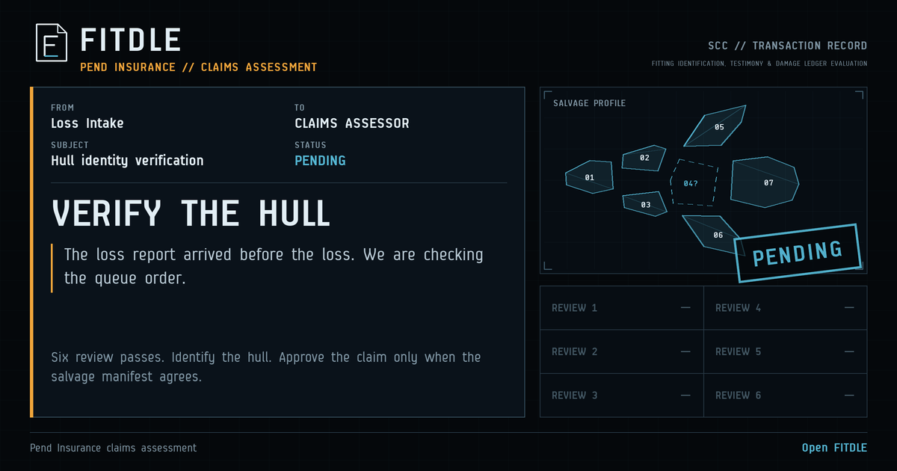

# FITDLE

[English](README.md) | 简体中文



EVE Online 猜船小游戏。给你一份 zKillboard 上真实的击毁报告，船名藏起来，只看属性、装配、货柜这些线索，猜是什么船。猜错一次，多给一点线索。

界面支持英、德、西、法、日、韩、俄、中 8 种语言。

## 玩法

- **标准**：猜错后揭示更多装备和货柜；你猜的船和答案相同的属性会直接亮出来。
- **装配审计**：属性按实际装配、全 V 技能算出来（用 [dogma-engine](https://github.com/EVEShipFit/dogma-engine)），猜测不显示相同属性，冷门船出现得更多，难一些。
- **计时**：线索按时间放出，跟猜了几次无关。

用 EVE SSO 登录后可以玩每日题（所有人同一题）；登录时玩的随机题也会计入战绩、统计和连胜。不登录就是见习模式，随便玩，不计分。从共享 KB 链接打开的击毁报告始终不计分。

联机房间支持上面三种玩法，外加一个轮流坐庄的「仲裁复核」玩法。

## 部署

需要一个 EVE 开发者应用（[developers.eveonline.com](https://developers.eveonline.com/)），回调地址填 `https://你的域名/api/v1/auth/eve/callback`。

```bash
cp .env.example .env   # 填 PUBLIC_ORIGIN、EVE_CLIENT_ID、EVE_CLIENT_SECRET、SESSION_SECRET
docker run -d --name fitdle --restart unless-stopped \
  --env-file .env -p 127.0.0.1:8787:8787 -v fitdle-data:/data \
  ghcr.io/steven-cmy/fitdle:latest
```

或者用 [compose.example.yml](compose.example.yml)。镜像 tag 有 `latest`、版本号（与 `package.json` 一致）、`v` 加版本号和 commit sha，想固定版本就把 `latest` 换掉。

> 镜像以前发布在 `registry.gitlab.com/cmy/fitdle`，现在改到 GHCR。旧地址不再更新，把镜像地址改成上面的即可，数据卷不用动。

几点说明：

- `SESSION_SECRET` 随便生成一个长随机串即可，例如 `openssl rand -base64 32`。
- 不填 SSO 也能跑，只是只有见习模式。
- 数据库是 `/data/fitdle.sqlite`，记得挂卷。
- Unraid 上设 `PUID=99`、`PGID=100`。
- 改了 `PUBLIC_ORIGIN` 要重建容器，光 restart 不行。
- 游戏日（每日题、连胜和刷新倒计时）默认从 UTC 11:00 开始。想改就设置 `FITDLE_GAME_DAY_START_UTC`，可以写 UTC 的 `HH:MM`（如 `12:30`），也可以写 UTC 0 点之后的分钟数（如 `750`），然后重建容器。写错了会在启动日志里提示，并按 11:00 处理。改动会移动当天游戏日的边界，所以每日题可能会换一次。
- 其他可选配置都在 [.env.example](.env.example) 里，有注释。

前面需要一个反代提供 HTTPS。注意房间用 WebSocket，`/api/v1/rooms/<code>/ws` 要带上升级头：

```nginx
location ~ ^/api/v1/rooms/[^/]+/ws$ {
    proxy_pass http://127.0.0.1:8787;
    proxy_http_version 1.1;
    proxy_set_header Host $host;
    proxy_set_header Upgrade $http_upgrade;
    proxy_set_header Connection "upgrade";
    proxy_read_timeout 3600s;
}

location / {
    proxy_pass http://127.0.0.1:8787;
    proxy_set_header Host $host;
    proxy_set_header X-Forwarded-For $proxy_add_x_forwarded_for;
    proxy_set_header X-Forwarded-Proto $scheme;
}
```

健康检查：`GET /api/v1/health`。只显示见习模式的话，先看 `/api/v1/meta` 和容器日志。

## 开发

Node 24+。前端是原生 ES modules，没有打包器；后端在 `server/`，Fastify + SQLite。

```bash
npm install
npm run prepare:sde       # 下载官方 SDE
npm run build:catalog
npm run build:killpool
npm run build:weights
npm run build             # 生成 data/ 和 dist/
npm test

npm install --prefix server
npm run test:server
npm run server:start      # http://127.0.0.1:8787
```

只看前端的话 `npm start`，打开 http://127.0.0.1:4173 （见习模式）。

改界面文字的话，8 种语言在 `js/messages/` 下，键名要保持一致，EVE 名词用官方译名（见 [docs/i18n-glossary.md](docs/i18n-glossary.md)）。更细的约定写在 [AGENTS.md](AGENTS.md)。

## CI

GitHub Actions（[.github/workflows/ci.yml](.github/workflows/ci.yml)）：向 `main` 的 PR 只构建和测试；改动了程序时要求新版本号和 CHANGELOG 章节，只改文档或 `.github/` 时不要求（日常推送到 `dev` 不触发任何流程）；合并到 `main` 后部署 [GitHub Pages](https://steven-cmy.github.io/fitdle/)（静态见习版）；当前版本还没有 Release 时，同时推送镜像到 GHCR，并在 CHANGELOG 有对应章节时创建 Release；已发布过的版本不会重复推送镜像，除非手动运行工作流。`dev` 的 PR 合并后，[reset-dev.yml](.github/workflows/reset-dev.yml) 会把 `dev` 重置到合并后的 `main`；如果 `dev` 之后又有变动，则保持原样，只在 PR 下留言说明。

## License

代码是 [MIT](LICENSE)。EVE Online、Pend Insurance、Secure Commerce Commission 的名称，以及游戏数据、图片和字体，归 Fenris Creations（原 CCP Games）所有，不在 MIT 范围内，详见 [NOTICE.md](NOTICE.md)。本项目是非官方粉丝作品，和 CCP、zKillboard 都没有关系。

`assets/fonts/` 里的 Eve Sans Neue、EveSans 和 Triglavian 是 EVE 的官方字体，版权归 Fenris Creations，只为这个粉丝项目附带，不要拿去别处用。删掉它们界面会退回系统字体，不影响功能。版权方有要求的话会立即移除，来源见 [NOTICE.md](NOTICE.md#fonts)。
